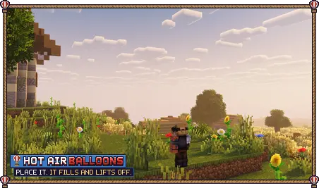
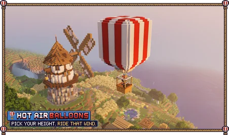
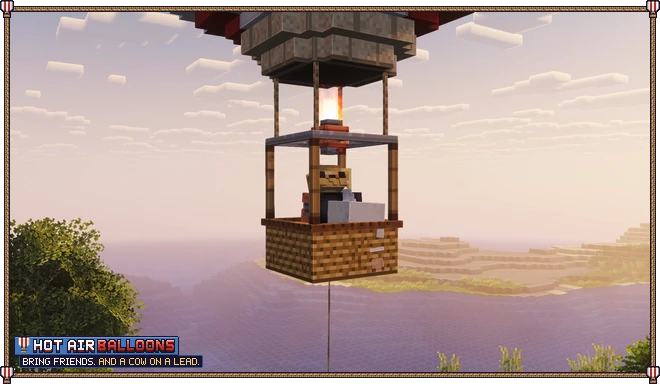
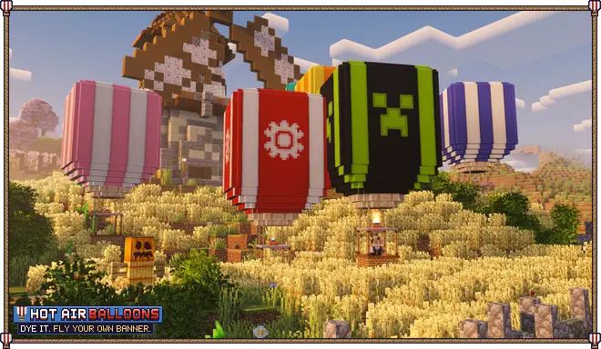

**Up, up and away.** Craft a hot air balloon from wool, string and a campfire, light the burner and drift over your world. Climb on the burner, let off heat to sink, steer a little and ride the wind, which blows a different way at every height. Take three friends or a few animals along, strap a chest to the basket, dye the envelope and fly your own banner on it. For Fabric on Minecraft 26.3, needed on the server and on every client.

## Features

- **A real balloon to fly**: the burner heats the envelope and you climb, vent to sink, and it hovers in between. Turn and nudge it along slowly.
- **Wind at every height**: each layer of sky blows its own way and turns over the days. Pick your height to pick your direction.
- **Four in the basket**: friends, or any animal that walks in while it stands on the ground. Lead a cow under it and it comes along on the rope.
- **A chest on board**: strap a chest to the basket and open it from inside with your inventory key.
- **Your colours**: dye the envelope and its stripes, and put any banner on it as an emblem. A dyed balloon keeps its look when you pick it up.
- **Mooring posts**: tie a balloon to a post with a lead and it waits where you left it, even in the air.
- **Burner fuel**: coal, charcoal, wood, blaze rods: anything a furnace burns. Carry some and the burner refuels itself.
- Gentle landings (nobody gets hurt), a soft sway, a roaring flame and wisps that show the wind.

## How to use

Craft a **Hot Air Balloon** (three wool on top, string, a campfire and string in the middle, three wooden slabs below) and use it on the ground to set it up. Click it to climb in.

- **Jump** (Space): burner, climb
- **Sprint** (Ctrl): vent, sink
- **Left/right**: turn; **forward/back**: a slow push
- **Sneak**: climb out

The gauges beside the hotbar show the heat (the white line is hover) and the fuel. Click the balloon with fuel to fill it, with a **dye** to colour the envelope (sneak for the stripes), with a **banner** to make it the emblem, with **shears** to take the emblem off, or with a **chest** to strap one on. Craft a **Mooring Post** (an iron nugget on two logs) and tie the balloon to it with a lead.

## Settings

Open the settings from Mod Menu. You can turn fuel off, change how fast the burner uses it, make the wind stronger or calmer, and stop mobs from climbing in. On a server, the server's `config/hotairballoons.json` decides.

## Installation

Put the jar in the `mods` folder of the server and of every player, with **Fabric API**.

To uninstall, remove the jar. Balloons and mooring posts in the world disappear with it. Settings live in `config/hotairballoons.json`.

## Support

Hot Air Balloons is free. If it took you somewhere nice, a coffee helps fund the next update.

Want your own server to fly with friends? My BisectHosting affiliate link gives you 25% off the first month, and I get a small commission.

## License

All rights reserved, with permissions: you can use it anywhere, include it in modpacks with credit, and show it in videos. Full terms: [LICENSE](https://github.com/ProfetGit/hot-air-balloons/blob/main/LICENSE).
